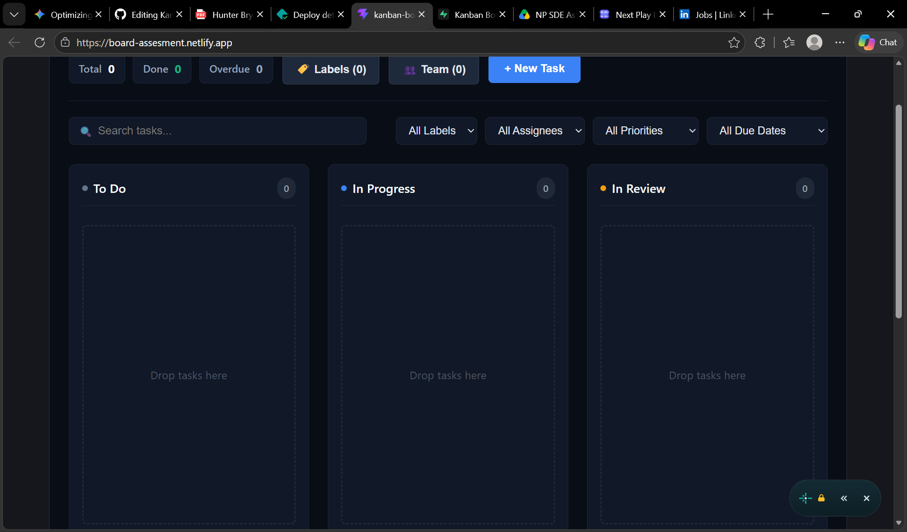

# 🚀 Kanban Board

> A full-stack Kanban board built with React and Supabase. It syncs in real time across tabs and devices, scopes data per user with row-level security, and starts every visitor in a guest workspace with no sign-up.



[](https://github.com/Hunter-Ryan-Bryant/Kanban-Board/actions/workflows/ci.yml)
[](https://board-assesment.netlify.app/)
[](https://supabase.com)
[](LICENSE)

---

## ✨ Key Features

- **📋 Four-column board:** To Do, In Progress, In Review and Done, with drag-and-drop between columns.
- **⚡ Real-time sync:** changes from other tabs and devices appear instantly through Supabase `postgres_changes` subscriptions. The app catches up automatically after a reconnect, and a header indicator shows the connection state.
- **👤 Guest sessions:** visitors are signed in anonymously through Supabase Auth, so they can start without an account. The session persists across reloads.
- **🛡️ Per-user data isolation:** every row carries a `user_id`, and row-level security (RLS) policies restrict each user to their own data.
- **🏷️ Labels and assignees:** create color-coded labels and team members, then tag and assign tasks.
- **📅 Due dates:** cards are highlighted as overdue, due today or due within two days.
- **💬 Task details:** a slide-over panel for editing fields inline, with comments and an activity log for each task.
- **🔍 Search and filters:** search titles and descriptions, and filter by label, assignee, priority or due-date urgency.
- **🧯 Resilient updates:** changes appear on screen immediately. If a save fails, the change is rolled back and an error message is shown.
- **♿ Accessible:** it works with a keyboard alone (cards open with Enter, and modals trap focus and close with Escape), labels every control for screen readers, and meets WCAG AA text contrast.

---

## 🛠️ Tech Stack

- **Frontend:** React 19, Vite, JavaScript, CSS Modules with design tokens (no CSS framework)
- **Backend / Database:** Supabase (PostgreSQL, Auth, Realtime, Row-Level Security)
- **Tooling & Deployment:** Vitest, oxlint, GitHub Actions, Netlify

---

## 🏗️ Architecture & Engineering Decisions

- **Supabase instead of a custom backend:** Postgres row-level security enforces authorization at the database layer, so the client talks to Supabase directly with no API server to maintain or secure.
- **Changes show before the save finishes:** the UI updates first and then saves to the database. If the save fails, the change is reverted and an error is shown.
- **Realtime handling:** the app's own writes come back through the subscription too, so incoming rows replace existing ones by id instead of being appended. That prevents duplicates. A remote update to the task being edited doesn't overwrite fields the user is typing in.
- **State management:** custom hooks hold the data and the logic, and components handle presentation:
  - `useWorkspace` covers the session, the four board collections, realtime sync and every write.
  - `useTaskDetail` covers the detail panel.
  - `useTaskFilters` covers search and filters.
- **The open task isn't a separate copy:** the detail panel shows the task from the board's list, plus any edits not yet saved. Remote updates and rollbacks appear in the panel automatically, without overwriting what the user is typing. Text fields save when they lose focus rather than on every keystroke.

### Project structure

```text
src/
├── App.jsx            # connects the hooks to the components
├── hooks/             # useWorkspace, useTaskDetail, useTaskFilters, useToast
├── components/        # Header, Toolbar, Board, TaskCard, TaskDrawer, modals and shared pieces,
│                      #   each with its own *.module.css; ui.module.css holds shared buttons and fields
├── lib/               # constants, helpers and filter logic, with their *.test.js files
├── index.css          # design tokens (colors, radii, motion) and global base styles
└── supabaseClient.js  # Supabase client and guest session helper
supabase/schema.sql    # tables, row-level security and realtime setup
.github/workflows/     # CI: lint, test and build on every push and PR
```

---

## 🏁 Getting Started Locally

### Prerequisites

- Node.js 20.19+ or 22.12+ (required by Vite 8)
- A free [Supabase](https://supabase.com) project

### 1. Clone and install

```bash
git clone https://github.com/Hunter-Ryan-Bryant/Kanban-Board.git
cd Kanban-Board
npm install
```

### 2. Configure environment variables

Copy the example file and fill in your project's values:

```bash
cp .env.example .env
```

Both values are under **Project Settings → API** in the Supabase dashboard. Use the publishable (anon) key, never the secret one.

### 3. Set up Supabase

1. **Enable anonymous sign-ins:** go to **Authentication → Sign In / Providers** and turn on **Allow anonymous sign-ins**.
2. **Create the database:** open the **SQL Editor**, paste in [`supabase/schema.sql`](supabase/schema.sql), and run it. It creates the six tables, turns on row-level security so each user only sees their own rows, and enables realtime. It's safe to run more than once.

### 4. Run the app

```bash
npm run dev         # start the dev server
npm test            # run the unit tests once
npm run test:watch  # rerun the tests as files change
npm run lint        # lint with oxlint
npm run build       # production build
```

`npm test` goes through [`scripts/vitest.mjs`](scripts/vitest.mjs). On Windows it uppercases the drive letter first, because Vitest fails to start when the terminal opens the folder as `c:\...`, as VS Code's often does.

---

## 📄 License

[MIT](LICENSE) © 2026 Hunter Bryant
